# Paalam: architecture

> **Problem statement (PromptWars x ACM SRM, Societal Benefit).** Build a Gemini-powered app that acts as a universal bridge between human intent and complex systems: take unstructured, messy, real-world input (voice, traffic, weather, news, photos, a stack of medical history) and instantly convert it into **structured, verified, life-saving actions**.

Paalam (பாலம், "bridge") is that bridge. It is **not** an app for one kind of crisis. Real crises don't arrive sorted: one family's WhatsApp on a flood night holds a rescue request, a medical risk and a scam at the same time. Paalam takes the whole pile, splits it, routes each piece to the specialist that can handle it, checks every claim against real data, and asks a human to approve each action.

---

## 1. The pipeline

```mermaid
flowchart LR
    subgraph IN["① Messy in"]
      V[Voice note<br/>16 kHz WAV]:::in
      P[Photos<br/>EXIF kept]:::in
      D[PDF / prescriptions]:::in
      T[Text, forwards,<br/>Tanglish]:::in
      L[Device location]:::in
    end

    subgraph ARGON["② Argon: orchestrator"]
      S[Split into distinct problems<br/>merge duplicates<br/>score urgency]
      R{Gem fits?}
      B[Design a new Gem<br/>from the tool registry]
    end

    subgraph GEMS["③ Gems in parallel"]
      G1[Flood Rescue]
      G2[Health Guard]
      G3[Scam Shield]
      G4[Road Responder]
      GN[…any Gem you or Argon build]
    end

    subgraph TOOLS["Tool registry: Google services"]
      direction TB
      t1[Search grounding]
      t2[Geocoding · Places · Routes]
      t3[Weather · Air Quality]
      t4[Photo freshness · Safe Browsing]
      t5[Cloud DLP · Translation · TTS]
      t6[openFDA labels]
    end

    TRUST["④ Trust layer<br/>(deterministic code, no model)"]
    ACT["⑤ Action cards<br/>human approves A / B"]
    OUT["Navigate · Call 108/112 · SMS SOS<br/>Share masked summary · Rescue request · Read back in Tamil"]

    IN --> S --> R
    R -- yes --> GEMS
    R -- no --> B --> GEMS
    GEMS <-->|only the tools ticked for that Gem| TOOLS
    GEMS --> TRUST --> ACT --> OUT
    classDef in fill:#eef,stroke:#88a
```



| Stage | Who | What happens | Model |
|---|---|---|---|
| ① Intake | server | Files become numbered **evidence** (E1, E2…). Photo EXIF date/GPS is read *before* anything else (WhatsApp strips it, and that absence is itself a signal). Voice is recorded as 16 kHz mono WAV in the browser: Gemini reads it directly, and it's small. | none |
| ② Split | **Argon** | Separates the input into distinct problems, merges duplicates, assigns urgency, routes each to one Gem. If nothing fits, Argon **designs a new Gem** on the spot from the tool registry and saves it. | `ARGON_MODEL` (fast model for short text-only input) |
| ③ Gems | each **Gem**, in parallel | **Pass 1, plan:** read only its evidence, draft facts, choose ≤ 8 tool calls. **Tools run** (only the tools ticked for that Gem; anything else is refused). **Pass 2, act:** with tool results, settle facts and propose 2–4 actions. | `GEM_MODEL` |
| ④ Verify | **trust layer** | Plain code, after the model. See §3. | none |
| ⑤ Act | **you** | Every action is a card: what, why, *exactly* what happens if approved, the evidence behind it, and what's still unknown. Nothing leaves without a tap. | none |

Everything is streamed to the browser over **Server-Sent Events**, so the Gems visibly wake up, work and finish.

---

## 2. Gems

A Gem is four things: **instructions · a model · allowed tools · knowledge**. It's the same idea as Gemini Gems and Socius's permissioned bots, except the tools are Google services.

| Gem | Handles | Tools |
|---|---|---|
| 🔵 Flood Rescue | flooding, people stranded, evacuation | geocode, weather, search_web, places_nearby, route, check_freshness, redact, translate, speak |
| 🟢 Health Guard | prescriptions, medicines, symptoms | drug_label, places_nearby, route, redact, translate, speak, search_web |
| 🟡 Scam Shield | forwards, fake relief, Aadhaar/OTP grabs | check_link, search_web, redact, translate, speak |
| 🔴 Road Responder | accidents, collapse, fire | geocode, places_nearby, route, weather, translate, speak |
| *any new Gem* | built in **Gem Studio** ("describe it → Argon designs it") or automatically by Argon mid-run | any subset |

**The "on the day" advantage:** whatever problem statement is announced, a new Gem takes about 2 minutes. The platform doesn't change.

Code: `server/gems/registry.ts` (starters, plus `data/gems.json` for custom ones), `server/argon.ts` (`draftGem`, `saveGem`).

---

## 3. Trust layer: Gemini doesn't mark its own homework

`server/trust.ts` runs **after** every Gem and calls no model, so a confident hallucination can't talk its way past it.

| Rule | Why |
|---|---|
| A fact may be **verified** only if it cites a tool call that succeeded. Otherwise it's downgraded and the trail says so. | "Structured" ≠ "true". JSON schema guarantees shape, not facts. |
| Citations to evidence or tools that don't exist are removed. | No invented sources. |
| Old or metadata-less photos become a **conflict** fact. | Catches 2018 viral flood photos. |
| Phone numbers in actions must be an official number from config or one a tool returned; otherwise the card shows "number not verified". | No hallucinated helplines. |
| Navigation targets must match a Places/Geocoding result. | No invented hospitals. |
| Text in SMS / share / request actions is **redacted** (Cloud DLP, or local Aadhaar/PAN/phone/card patterns) before it can leave. | Privacy by default. |
| Every action starts as `awaiting`. | Human in the loop, always. |

Each fact carries: **status** (reported / inferred / unknown), **verification** (verified / unverified / conflict), **verifiedBy** tool and time, and **sources** (E- and T-ids). The UI shows all of it, so every claim is auditable.

---

## 4. Harness: how the models are kept on track (and cheap)

`server/harness/` holds the playbooks every call starts from, the token budget, and the notes models write for themselves.

**Playbooks.** `argon.md` and `gem.md` are Markdown, hot-reloaded on edit (no restart). They define each role, the two-pass method, fact and verification semantics, the fixed safety rules and the output discipline.

**Not a cage: self-written notes.** Argon and each Gem may return a `harnessNote`: one rule of 25 words or fewer they'd want next time. It's appended to that agent's playbook (max 8 per agent; the oldest retires first). A note that tries to weaken verification, approval or redaction is **refused** and logged. You can review and delete notes on the Harness screen.

**Token economy:**

| Lever | Default | Env var |
|---|---|---|
| Per-run ceiling across all calls; past it, Gems finish from pass 1 without pass 2 | 60 000 | `RUN_TOKEN_BUDGET` |
| Argon thinking budget / max output | 1024 / 2048 | `ARGON_THINKING_BUDGET`, `ARGON_MAX_OUTPUT` |
| Gem thinking budget / max output | 0 / 2048 | `GEM_THINKING_BUDGET`, `GEM_MAX_OUTPUT` |
| Image resolution: Argon low (routing needs gist), Gems medium (prescriptions need detail) | | |
| Short text-only input is routed by the fast model, not Argon's | < 600 chars | `ROUTER_DOWNSHIFT_CHARS` |
| Each Gem sees **only its own evidence**, not the whole pile | | |
| Pass 2 is **text only**: media was read once in pass 1 | | |
| Tool data trimmed before going back to a Gem | 600 chars | `TOOL_DATA_CHARS` |
| Unsupported options (e.g. thinking budget on some models) are dropped automatically and retried | | |

Every call's input, output and thinking tokens are metered per step and shown under the run's audit trail.

---

## 5. Tool registry (Google services as tools)

`server/tools/index.ts`. Every tool has a **live** path (real API) and a **demo** path (labelled fixture) so the app always works; each result carries `demo: true|false` and the UI shows LIVE or DEMO on it.

| Tool | Live API | Key |
|---|---|---|
| `search_web` | Gemini + Google Search grounding (returns sources) | `GEMINI_API_KEY` |
| `geocode` | Geocoding API (region=in) | `GOOGLE_MAPS_API_KEY` |
| `places_nearby` | Places API (New) `searchText`, open-now + phone | `GOOGLE_MAPS_API_KEY` |
| `route` | Routes API `computeRoutes`, traffic-aware, GeoJSON polyline | `GOOGLE_MAPS_API_KEY` |
| `weather` | Weather API `currentConditions` | `GOOGLE_MAPS_API_KEY` |
| `air_quality` | Air Quality API + health recommendations | `GOOGLE_MAPS_API_KEY` |
| `check_freshness` | EXIF date/GPS (built in) | none |
| `check_link` | Safe Browsing v4 + Indian scam patterns | `GOOGLE_CLOUD_API_KEY` |
| `redact` | Cloud DLP `deidentify` (service account) or local patterns | `GOOGLE_APPLICATION_CREDENTIALS` |
| `translate` | Cloud Translation v2 | `GOOGLE_CLOUD_API_KEY` |
| `speak` | Cloud Text-to-Speech (ta-IN) or browser voice | `GOOGLE_CLOUD_API_KEY` |
| `drug_label` | openFDA drug labels | none |

Adding a tool = one object in the registry. Every Gem can then tick it.

---

## 5b. Browser

`server/browser/`. Three levels, each gated more tightly than the last:

| Level | Tool / action | What it does | Guard |
|---|---|---|---|
| Read | `read_url` tool | Fetch a public page as text | URL check plus DNS check on every redirect; private, local and metadata addresses refused |
| See | `browse` tool | Open the page in Chrome/Chromium; return its text, its **form fields** (labels, required, options) and a screenshot | Every request the page makes is re-checked; screenshots are stored by id and never sent to a model |
| Act | `browser_fill` action | Fill the fields a human approved, field by field, then **stop** | Card lists every field and value; passwords, OTPs, PINs and card fields are refused at the trust layer *and* in the browser; a separate `browser_submit` card is needed to send |

The demo uses Paalam's own **practice form** (`/practice/complaint`), clearly labelled and sending nowhere, so the flow can be shown offline without imitating any real site.

## 5c. Plugins

`server/plugins.ts` loads `plugins/tools/*.ts|js` (default-export a tool) and `plugins/gems/*.json` at startup and on **Settings → Plugins → Reload**. Plugin tools can't replace built-ins; plugin Gems can't be overwritten from the UI. Guide: [PLUGINS.md](PLUGINS.md).

## 5d. Knowledge, similar reports, shield, saving

| Module | What it does | Without keys |
|---|---|---|
| `server/knowledge.ts` | Chunks `knowledge/*.md`, embeds with Gemini Embeddings (cached in `data/`), `knowledge_search` returns cited passages | Keyword search |
| `server/incidents.ts` | Every finished problem is embedded; `similar_reports` finds earlier Bridges about the same incident, boosted by map distance | Keyword overlap |
| `server/screen.ts` | Model Armor `sanitizeUserPrompt` on the person's input and on every page `read_url`/`browse` reads; flagged text is marked and read as data only | Local injection patterns |
| `server/store.ts` | Saves runs and incidents; restores them on start (interrupted runs are marked) | JSON files in `data/` |
| `gemini.ts → checkModels` | Confirms each configured model exists on the key at startup; the Keys screen shows ✓/✕ | n/a |

## 6. Actions and what really happens

`server/execute.ts`. Runs only after approval.

| Kind | On approve |
|---|---|
| navigate | Opens Google Maps directions to the verified place |
| call | Opens the dialer (`tel:`) and copies a read-out script |
| sms | Twilio when configured; otherwise **simulated**, with the text copied for you |
| share | Copies the redacted text (paste into WhatsApp) |
| request / alert | **Simulated** control-room dispatch, logged as an incident. A real integration needs an agency API |
| readback | Cloud TTS in Tamil, or the browser voice |
| warn | Marks it on this device |
| browser_fill | Opens the page, fills the approved fields, screenshots it, **stops**; adds a Submit card |
| browser_submit | Presses submit on the page Paalam is holding (15-minute limit), screenshots the result |
| poster | Gemini image model draws a shareable poster from the approved headline and lines; falls back to a plain drawn poster |

Anything simulated says so in its result. Nothing pretends to have been sent.

---

## 7. Code map

```
server/
  index.ts          Express API, SSE stream, approvals, serves dist/
  argon.ts          orchestrator: split → route → Gems (plan → tools → act) → trust
  trust.ts          deterministic verification + redaction gate
  execute.ts        what an approved action does
  gemini.ts         Gemini client (AI Studio key or Vertex), budgeted JSON calls, grounding
  schemas.ts        responseJsonSchema for split / plan / act / gem draft
  harness/          playbooks (.md), budget, self-written notes, usage meter
  gems/registry.ts  starter Gems + saved ones
  tools/            registry, redaction, HTTP helpers, demo fixtures
  demo/scenario.ts  the no-key demo (scripted Gemini answers; tools still run)
  config.ts         env → config; which integrations are live
web/
  App.tsx           shell, routing, home
  views/            RunView, GemStudio, Harness, Integrations
  components/       Gem (living crystal), Constellation, Composer, FactTable, ActionCard, MapView
public/             PWA manifest, icon, service worker
```

---

## 8. Slots still to fill (your keys)

All in `.env` (template: `.env.example`). Each one switches its tools from DEMO to LIVE; the Integrations screen shows which are on.

- [ ] `GEMINI_API_KEY` (or `GOOGLE_CLOUD_PROJECT` + `GOOGLE_APPLICATION_CREDENTIALS` for Vertex), plus `ARGON_MODEL`, `GEM_MODEL`: the exact model IDs in your project
- [ ] `GOOGLE_MAPS_API_KEY`: the `maps-key`
- [ ] `GOOGLE_CLOUD_API_KEY`: Translation, TTS, Safe Browsing
- [ ] `GOOGLE_APPLICATION_CREDENTIALS`: path to the `paalam` service-account JSON (Cloud DLP)
- [ ] Twilio (optional): real SMS
- [ ] Firestore (next): persist runs and Gems instead of memory + `data/`

## 9. Deploy

```bash
gcloud run deploy paalam --source . --region asia-south1 --allow-unauthenticated \
  --set-env-vars ARGON_MODEL=…,GEM_MODEL=… \
  --set-secrets GEMINI_API_KEY=gemini-key:latest,GOOGLE_MAPS_API_KEY=maps-key:latest
```

Keys go in Secret Manager, never in the image.
